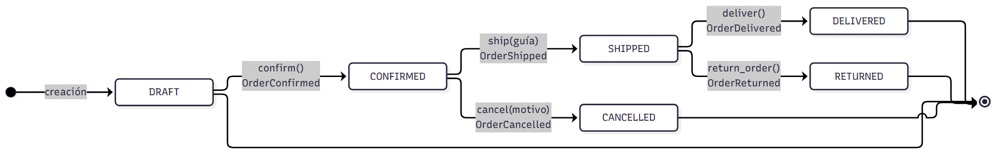

# Máquina de estados y Domain Events

Entregable de la sección 9 de `CLN_U4_Practica_Guiada_Alumnos_TechStore.pdf`
("Máquina de estados y Domain Events") y de la sección 13 ("Diagrama de estados y
explicación de los Domain Events").

## 1. Diagrama



*Render: `docs/diagramas/estados.png` (1800 × 278 px). Las fuentes editables
están en la carpeta [`docs/diagramas/`](diagramas/README.md):
[`estados.mmd`](diagramas/estados.mmd) (Mermaid) y
[`estados.puml`](diagramas/estados.puml) (PlantUML).*

Los demás diagramas del proyecto (clases, specifications y secuencia) están en
la misma carpeta, con su índice en [`diagramas/README.md`](diagramas/README.md).

## 2. Transiciones permitidas

| Desde | Hasta | Método | Precondición | Evento emitido |
|---|---|---|---|---|
| DRAFT | CONFIRMED | `confirm()` | tiene renglones **y** cliente activo | `OrderConfirmed` |
| CONFIRMED | SHIPPED | `ship(guía)` | estado CONFIRMED **y** guía no vacía | `OrderShipped` |
| SHIPPED | DELIVERED | `deliver()` | estado SHIPPED | `OrderDelivered` |
| SHIPPED | RETURNED | `return_order()` | estado SHIPPED | `OrderReturned` |
| CONFIRMED | CANCELLED | `cancel(motivo)` | estado CONFIRMED **y** motivo no vacío | `OrderCancelled` |

## 3. Transiciones prohibidas

Todas lanzan `InvalidOrderTransition` (salvo las de datos incompletos, que lanzan
`InvalidOrderData`) y **no cambian el estado ni agregan eventos**.

| Operación | Estado inválido | Excepción | Caso |
|---|---|---|---|
| `confirm()` | CONFIRMED o posterior | `InvalidOrderTransition` | E12 (O013) |
| `ship()` | ≠ CONFIRMED | `InvalidOrderTransition` | — |
| `cancel()` | ≠ CONFIRMED | `InvalidOrderTransition` | E13 (O014) |
| `deliver()` | ≠ SHIPPED | `InvalidOrderTransition` | — |
| `return_order()` | ≠ SHIPPED | `InvalidOrderTransition` | — |
| `add_item()` | ≠ DRAFT | `InvalidOrderTransition` | — |
| `ship("")` | CONFIRMED | `InvalidOrderData` | E11 (O012) |
| `cancel("")` | CONFIRMED | `InvalidOrderData` | — |

## 4. Los Domain Events

### Qué son

`DomainEvent` (`app/domain.py`) es un objeto inmutable con tres datos:

```python
@dataclass(frozen=True)
class DomainEvent:
    name: str          # "OrderConfirmed", "OrderShipped", ...
    order_id: str      # "O013"
    occurred_at: datetime  # UTC, con default_factory
```

El pedido los acumula en `order.events`. Cada transición válida deja **exactamente un**
evento: `OrderConfirmed`, `OrderShipped`, `OrderDelivered`, `OrderReturned` y
`OrderCancelled`.

### Por qué se registran solo después de una transición válida

Todos los métodos de transición del aggregate siguen **el mismo orden en tres pasos**:

```python
def confirm(self):
    if self.status != OrderStatus.DRAFT:          # 1. validar
        raise InvalidOrderTransition("Solo DRAFT")
    if not self.items or not self.customer.active:
        raise InvalidOrderData("Requiere artículos y cliente activo")
    self.status = OrderStatus.CONFIRMED            # 2. cambiar el estado
    self.events.append(DomainEvent("OrderConfirmed", self.id))   # 3. registrar
```

El evento se agrega **al final**, y solo si las validaciones pasaron. Si se anotara
antes, un `confirm()` fallido dejaría un `OrderConfirmed` que nunca ocurrió: la bitácora
de auditoría mentiría y el estado real del pedido no coincidiría con su historia.

El efecto observable es que `order.events` es una **historia veraz**: el número de
eventos coincide con el número de transiciones que realmente ocurrieron. La prueba
`test_operaciones_invalidas_no_cambian_estado_ni_eventos` (12 casos parametrizados)
verifica exactamente esa propiedad.

### Para qué sirven

1. **Auditoría del pedido.** `GET /orders/{id}` expone la historia completa del pedido.
2. **Desacoplar efectos secundarios.** Cuando el laboratorio crecerá (notificar por
   correo, generar factura, descontar inventario), los *handlers* se suscribirán a
   estos eventos **fuera** del aggregate. Hoy no hay efectos secundarios, y por eso el
   dominio no depende de ninguno.
3. **Prueba del comportamiento.** Un evento es la evidencia observable de que una
   transición ocurrió; las pruebas comparan listas de nombres de evento en lugar de
   consultar el estado interno del pedido.

### Registro observado en los datos

| Pedido | Recorrido | Eventos |
|---|---|---|
| O013 | DRAFT → CONFIRMED (2.ª confirmación rechazada) | `OrderConfirmed` |
| O015 | DRAFT → CONFIRMED → SHIPPED → RETURNED | `OrderConfirmed`, `OrderShipped`, `OrderReturned` |
| O016 | DRAFT → CONFIRMED → SHIPPED → DELIVERED | `OrderConfirmed`, `OrderShipped`, `OrderDelivered` |

Evidencia reproducible: `docs/evidencias/02_maquina_estados.txt`.
