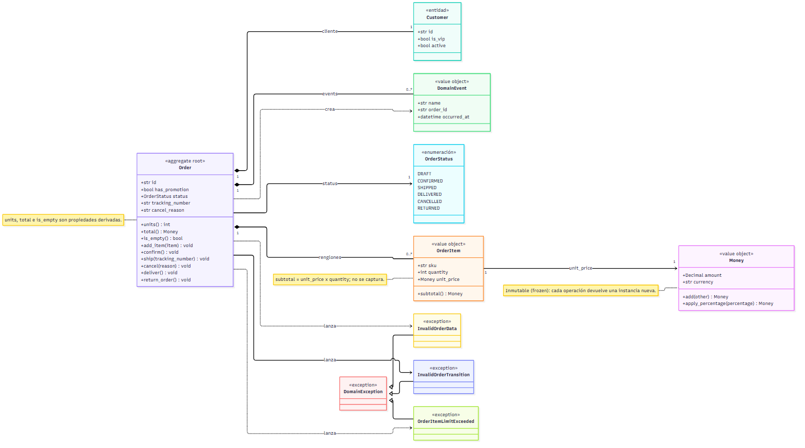
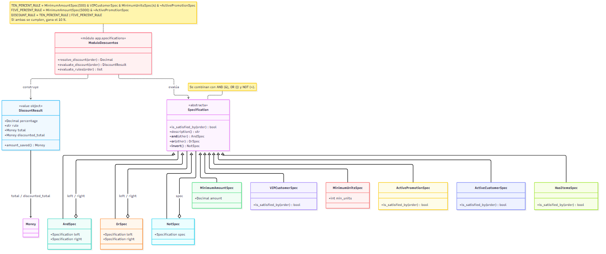
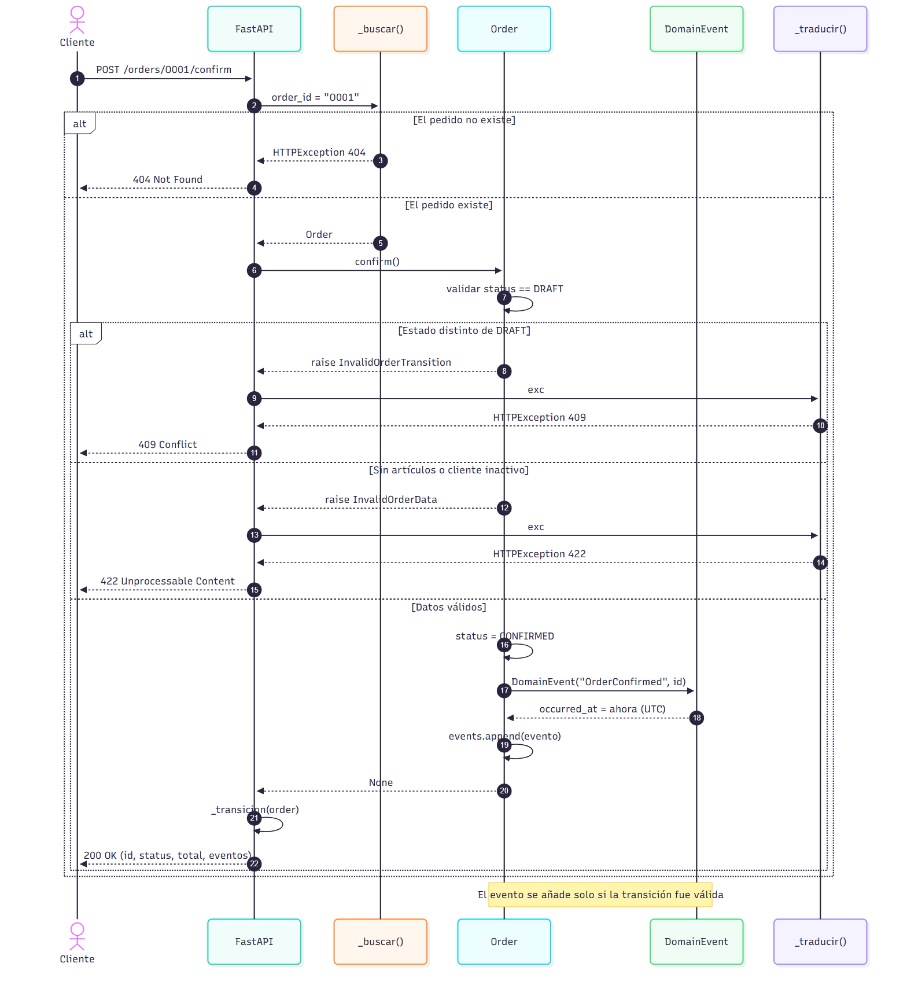
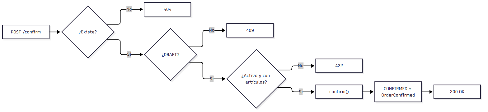

# Diagramas UML — TechStore U4

Carpeta dedicada a los diagramas del proyecto, separada de las capturas de
evidencias. Cada diagrama se entrega en cuatro formatos:

* **`.mmd`** — fuente Mermaid (editable; GitHub la renderiza y `mermaid-cli` la
  convierte a imagen).
* **`.puml`** — fuente PlantUML, el formato UML clásico del curso.
* **`.png`** — render listo para el reporte.
* **`.svg`** — render vectorial, nítido a cualquier zoom y legible por
  herramientas de texto.

> Los `.png` y `.svg` se generaron con Mermaid (`mermaid-cli`) porque en el
> equipo de desarrollo no hay Java ni `plantuml.jar`. Los `.puml` son la fuente
> UML equivalente y se pueden renderizar en
> [plantuml.com](https://www.plantuml.com/plantuml/uml/) o con la extensión de
> PlantUML para VS Code.

## Índice

| # | Diagrama | Render | Fuentes |
|---|---|---|---|
| 1 | Máquina de estados de `Order` | [`estados.png`](estados.png) · [`estados.svg`](estados.svg) | [`estados.mmd`](estados.mmd) · [`estados.puml`](estados.puml) |
| 2 | Modelo de dominio (clases) | [`clases.png`](clases.png) · [`clases.svg`](clases.svg) | [`clases.mmd`](clases.mmd) · [`clases.puml`](clases.puml) |
| 3 | Patrón Specification y descuentos | [`especificaciones.png`](especificaciones.png) · [`especificaciones.svg`](especificaciones.svg) | [`especificaciones.mmd`](especificaciones.mmd) · [`especificaciones.puml`](especificaciones.puml) |
| 4 | Secuencia de `POST /orders/{id}/confirm` | [`secuencia-confirmar.png`](secuencia-confirmar.png) · [`secuencia-confirmar.svg`](secuencia-confirmar.svg) | [`secuencia-confirmar.mmd`](secuencia-confirmar.mmd) · [`secuencia-confirmar.puml`](secuencia-confirmar.puml) |
| 5 | Flujo de decisión de `POST /orders/{id}/confirm` | [`flujo-confirmacion.png`](flujo-confirmacion.png) · [`flujo-confirmacion.svg`](flujo-confirmacion.svg) | [`flujo-confirmacion.mmd`](flujo-confirmacion.mmd) · [`flujo-confirmacion.puml`](flujo-confirmacion.puml) |

---

## 1. Máquina de estados


Estados de `Order` y las cinco transiciones válidas. Cada transición deja
**exactamente un** `DomainEvent`: `OrderConfirmed`, `OrderShipped`,
`OrderDelivered`, `OrderReturned` o `OrderCancelled`. El evento se registra
solo después de validar y cambiar el estado, de modo que `order.events` es una
historia veraz.

Explicación completa (transiciones prohibidas y Domain Events):
[`../DIAGRAMA_ESTADOS.md`](../DIAGRAMA_ESTADOS.md).

## 2. Modelo de dominio (clases)



* `Order` es el **aggregate root**: único punto de entrada para modificar un pedido.
* `Money` y `OrderItem` son **value objects** inmutables (`frozen=True`);
  `subtotal` se calcula, nunca se captura.
* `Customer` es una **entidad** con identidad (`id`).
* `OrderStatus` es la enumeración de estados y `DomainEvent` el hecho ya ocurrido.
* Las tres excepciones heredan de `DomainException` y la API las traduce a HTTP.

## 3. Patrón Specification y reglas de descuento



`Specification` define el predicado `is_satisfied_by(order)` y se compone con
`&` (AND), `|` (OR) y `~` (NOT) sin duplicar reglas. Las reglas del negocio son:

* **10 %**: VIP, total > 500 MXN, ≥ 4 unidades y sin promoción.
* **5 %**: total > 5000 MXN y sin promoción.
* Si ambas se cumplen, se aplica primero el **10 %**.

`DiscountResult` devuelve el porcentaje, el total bruto, el total con descuento
y el importe ahorrado. El total del pedido **no se modifica**.

## 4. Secuencia de confirmación



Recorrido de `POST /orders/{order_id}/confirm`: el controlador localiza el
pedido (`_buscar`), delega la regla en `Order.confirm()` y traduce la excepción
de dominio (`_traducir`) al código HTTP correspondiente:

| Situación | Código |
|---|---|
| El pedido no existe | **404** |
| La transición no está permitida desde el estado actual | **409** |
| Pedido sin artículos o cliente inactivo | **422** |
| Transición válida | **200** |

## 5. Flujo de decisión de la confirmación



Vista de flujo del mismo caso, útil para leer la **secuencia de validaciones**
sin entrar al detalle de los objetos:

1. ¿Existe el pedido? → si no, **404**.
2. ¿Está en `DRAFT`? → si no, **409**.
3. ¿Cliente activo y con artículos? → si no, **422**.
4. `Order.confirm()` cambia a `CONFIRMED`, registra `OrderConfirmed` y responde
   **200**.

La decisión de negocio vive en el agregado; el diagrama solo documenta el orden
en que la API traduce cada fallo.

---

## Cómo regenerar los renders

Desde esta carpeta, con `mermaid-cli` instalado:

```powershell
mmdc -i estados.mmd -o estados.png -b white -s 2
mmdc -i estados.mmd -o estados.svg -b white

mmdc -i clases.mmd -o clases.png -b white -s 2
mmdc -i clases.mmd -o clases.svg -b white

mmdc -i especificaciones.mmd -o especificaciones.png -b white -s 2
mmdc -i especificaciones.mmd -o especificaciones.svg -b white

mmdc -i secuencia-confirmar.mmd -o secuencia-confirmar.png -b white -s 2
mmdc -i secuencia-confirmar.mmd -o secuencia-confirmar.svg -b white

mmdc -i flujo-confirmacion.mmd -o flujo-confirmacion.png -b white -s 2
mmdc -i flujo-confirmacion.mmd -o flujo-confirmacion.svg -b white
```

Si el navegador de `mermaid-cli` no arranca, se le puede indicar un Chromium
instalado (por ejemplo Edge) con un archivo `puppeteer.json`:

```json
{
  "executablePath": "C:\\Program Files (x86)\\Microsoft\\Edge\\Application\\msedge.exe",
  "args": ["--no-sandbox", "--disable-gpu", "--disable-dev-shm-usage"]
}
```

y añadir `--puppeteerConfigFile puppeteer.json` al comando.

Para los `.puml`, abrirlos en [plantuml.com](https://www.plantuml.com/plantuml/uml/)
o usar la extensión de PlantUML (requiere Java). El contenido es equivalente al
de los `.mmd`.

## Verificación rápida de los renders

| Diagrama | Tamaño del PNG | Etiquetas verificadas |
|---|---|---|
| `estados.png` | 1350 × 209 | 6/6 estados |
| `clases.png` | 1176 × 656 | 5/5 clases |
| `especificaciones.png` | 1176 × 495 | 4/4 conceptos |
| `secuencia-confirmar.png` | 1176 × 1296 | 4/5 etiquetas (la llamada se dibuja en dos líneas) |
| `flujo-confirmacion.png` | 1176 × 272 | 7/7 etiquetas |
